<p align="center"></p>

<p align="center"><b>MÓDULO SAT</b></p>

<h1 align="center">Carga Factura Fel Excel</h1>

<p align="center"><b>Guía funcional del aplicativo</b><br>
Qué hace, cómo se usa y en qué ayuda el traslado de documentos FEL de compras y ventas.<br>
Noviembre de 2026</p>

---

> **Cómo está organizado este documento**
>
> - **Parte A. Guía funcional:** el contenido de la guía del aplicativo, sin cambios, con sus imágenes.
> - **Parte B. Documentación técnica:** endpoints del API, procedimientos almacenados, tablas, diagramas de flujo y diagrama entidad-relación del proceso.

---

# Parte A. Guía funcional

Guía para entender qué hace este aplicativo, cómo se usa y en qué ayuda. Está pensada para cualquier persona (contabilidad, soporte, usuarios nuevos o personal de desarrollo que llega por primera vez), sin necesidad de conocimientos técnicos.

## Contenido

1. [¿Qué es?](#1-qué-es)
2. [¿En qué ayuda?](#2-en-qué-ayuda)
3. [Conceptos que conviene conocer](#3-conceptos-que-conviene-conocer)
4. [¿Cómo se entra al aplicativo?](#4-cómo-se-entra-al-aplicativo)
5. [La pantalla de un vistazo](#5-la-pantalla-de-un-vistazo)
6. [Paso 1 — Elegir Compras o Ventas](#6-paso-1--elegir-compras-o-ventas)
7. [Paso 2 — Cargar el archivo Excel](#7-paso-2--cargar-el-archivo-excel)
8. [Paso 3 — Trasladar los datos](#8-paso-3--trasladar-los-datos)
9. [Paso 4 — Revisar el resultado](#9-paso-4--revisar-el-resultado)
   - [9.1 Resumen de cifras de control (anuladas)](#91-resumen-de-cifras-de-control-anuladas)
   - [9.2 Ejecutados y No ejecutados](#92-ejecutados-y-no-ejecutados)
   - [9.3 Atajo: del documento a su anulación](#93-atajo-del-documento-a-su-anulación)
10. [Consultar documentos ya guardados](#10-consultar-documentos-ya-guardados)
11. [Totales de impuestos (cifras de control)](#11-totales-de-impuestos-cifras-de-control)
12. [Anular o reactivar documentos](#12-anular-o-reactivar-documentos)
    - [12.1 Buscar](#121-buscar)
    - [12.2 Marcar cambios (sin guardar todavía)](#122-marcar-cambios-sin-guardar-todavía)
    - [12.3 Guardar](#123-guardar)
13. [El recorrido completo](#13-el-recorrido-completo)
14. [Preguntas frecuentes y recomendaciones](#14-preguntas-frecuentes-y-recomendaciones)
15. [Resumen](#15-resumen)

**Parte B. Documentación técnica**

- [B1. Arquitectura del proceso](#b1-arquitectura-del-proceso)
- [B2. Endpoints que utiliza el proceso](#b2-endpoints-que-utiliza-el-proceso)
- [B3. Formato del archivo Excel](#b3-formato-del-archivo-excel)
- [B4. Procedimientos almacenados](#b4-procedimientos-almacenados)
- [B5. Tablas donde se guarda la información](#b5-tablas-donde-se-guarda-la-información)
- [B6. Diagrama entidad-relación](#b6-diagrama-entidad-relación)
- [B7. Diagramas de flujo técnicos](#b7-diagramas-de-flujo-técnicos)
- [B8. Observaciones técnicas](#b8-observaciones-técnicas)

---

## 1. ¿Qué es?

Es un proceso del sistema, identificado en pantalla como **MÓDULO SAT**, que sirve para llevar al sistema los **documentos electrónicos (FEL)** de **compras** o de **ventas** de la empresa, a partir de un archivo de Excel, y luego revisarlos, sacar sus totales de impuestos y corregir su estado (anulado o activo).

En pocas palabras: el usuario entrega un Excel con sus facturas electrónicas y el aplicativo las guarda, le dice cuáles se guardaron y cuáles no, le muestra cuánto suman los impuestos y le permite marcar como anuladas (o volver a activar) las que correspondan.

<p align="center">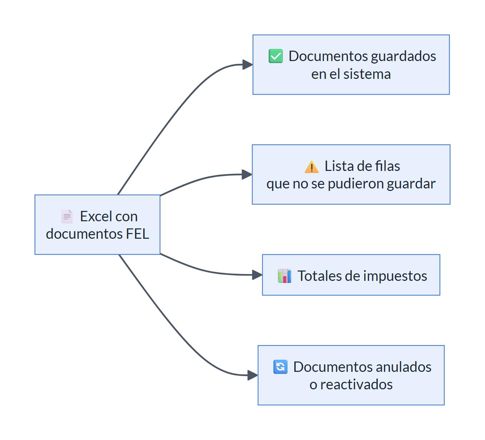</p>

## 2. ¿En qué ayuda?

| Sin el aplicativo | Con el aplicativo |
|---|---|
| Hay que digitar o importar a mano cada factura electrónica de compras y ventas. | Se carga un solo Excel y el sistema registra todos los documentos de una vez. |
| Es difícil saber qué facturas quedaron registradas y cuáles no. | Se ven en dos listas separadas: las que sí se guardaron y las que no. |
| Sumar IVA y demás impuestos por periodo requiere hojas de cálculo aparte. | El aplicativo calcula los totales de cada impuesto para el rango de fechas que se elija. |
| Cuando un documento se anula ante la SAT, hay que buscarlo y corregirlo uno por uno. | Se buscan los documentos, se marcan los que hay que anular o reactivar y se guardan todos juntos, revisándolos antes. |

**Beneficios principales:**

- **Ahorra tiempo:** cientos de documentos se registran en un solo paso.
- **Reduce errores:** el usuario ve de inmediato qué no se pudo guardar.
- **Facilita el control fiscal:** los totales de impuestos están a un clic, por periodo.
- **Mantiene la información al día:** el estado de anulación de los documentos se corrige fácilmente.
- **Separa compras de ventas:** cada tipo se trabaja por aparte para no mezclar información.

## 3. Conceptos que conviene conocer

| Concepto | Qué significa aquí |
|---|---|
| **SAT** | Superintendencia de Administración Tributaria de Guatemala. |
| **FEL** | Factura Electrónica en Línea: el sistema de documentos electrónicos de la SAT. |
| **DTE** | Documento Tributario Electrónico (factura, nota de crédito, etc.). |
| **NIT** | Número de identificación tributaria de quien emitió el documento. |
| **Serie y número de documento** | Los datos que identifican a cada documento FEL. |
| **Compras / Ventas** | El tipo de documentos con el que se va a trabajar. Siempre se trabaja con uno a la vez. |
| **Trasladar** | Pasar los documentos del Excel al sistema. |
| **Ejecutados** | Documentos que quedaron guardados en el sistema. |
| **No ejecutados** | Filas del Excel que el sistema no pudo guardar. |
| **Cifras de control** | Totales calculados por el sistema: cantidad de documentos y suma de cada impuesto. |
| **Anulado / Activo** | Estado del documento. Un documento anulado ya no tiene validez. |

## 4. ¿Cómo se entra al aplicativo?

El aplicativo se abre desde el **Menú** (la pantalla de inicio después de iniciar sesión), con la opción **Carga Factura Fel Excel**. A nivel de configuración del sistema el proceso se identifica como `prcFacturaFelCompra`. Siempre trabaja con la **empresa** con la que se inició sesión.

<p align="center">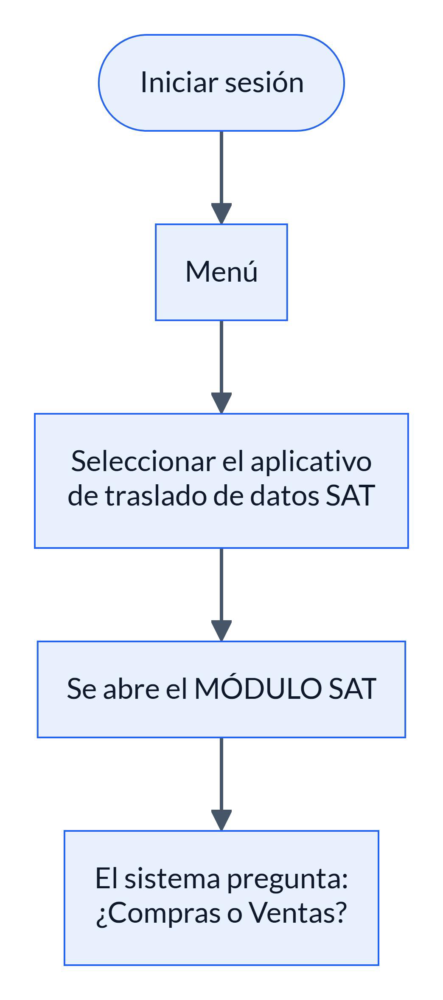</p>

> Si se refresca la página del navegador (F5) estando dentro del aplicativo, el sistema regresa al Menú y hay que volver a entrar desde allí.

Para volver al Menú en cualquier momento se usa el enlace **INICIO** del encabezado.

## 5. La pantalla de un vistazo

Así se ve la pantalla principal con un archivo ya cargado:

<p align="center">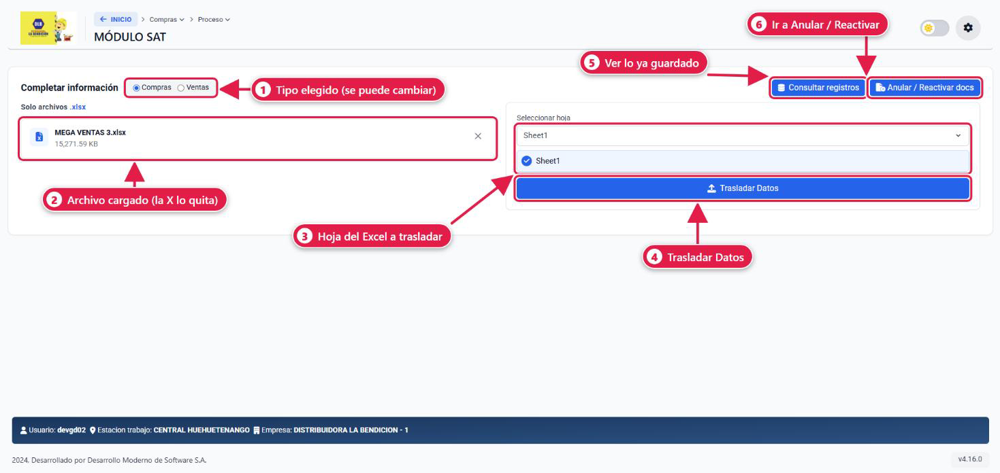<br>
<i>Figura 1. Pantalla principal del aplicativo con un archivo Excel cargado</i></p>

1. **Tipo elegido**: indica si se trabaja con Compras o Ventas. Se puede cambiar aquí mismo.
2. **Archivo cargado**: nombre y tamaño del Excel. La **X** lo quita para cargar otro.
3. **Hoja del Excel**: la hoja que contiene los documentos.
4. **Trasladar Datos**: guarda los documentos en el sistema.
5. **Consultar registros**: muestra lo que ya está guardado, sin cargar ningún archivo.
6. **Anular / Reactivar docs**: cambia a la vista para corregir el estado de los documentos.

Debajo de esta área aparecen los resultados después de trasladar o consultar (resumen de anulados, pestañas de Ejecutados / No ejecutados y totales de impuestos).

La pantalla tiene **dos vistas**, y se cambia entre ellas con el botón de la esquina:

<p align="center">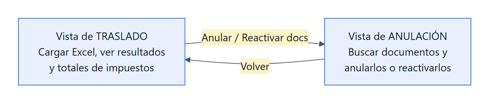</p>

## 6. Paso 1 — Elegir Compras o Ventas

Lo primero que aparece al entrar es un aviso de **«Selección requerida»**: el usuario debe indicar si va a trabajar con **Compras** o con **Ventas**. No se puede continuar sin elegir, porque esta decisión define dónde se guardarán y de dónde se consultarán los documentos.

<p align="center">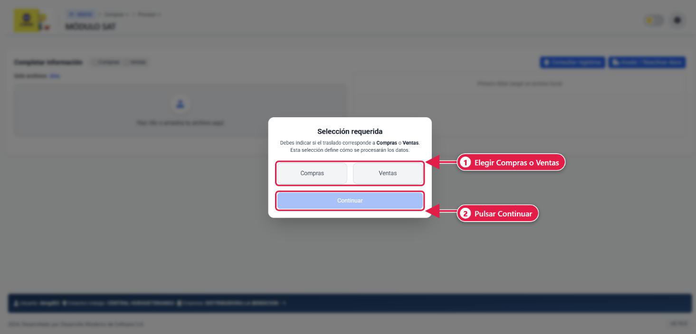<br>
<i>Figura 2. Aviso «Selección requerida» al entrar al aplicativo</i></p>

1. Se elige **Compras** o **Ventas** (la opción elegida queda resaltada).
2. Se pulsa **Continuar**. El botón se activa solo después de elegir.

<p align="center">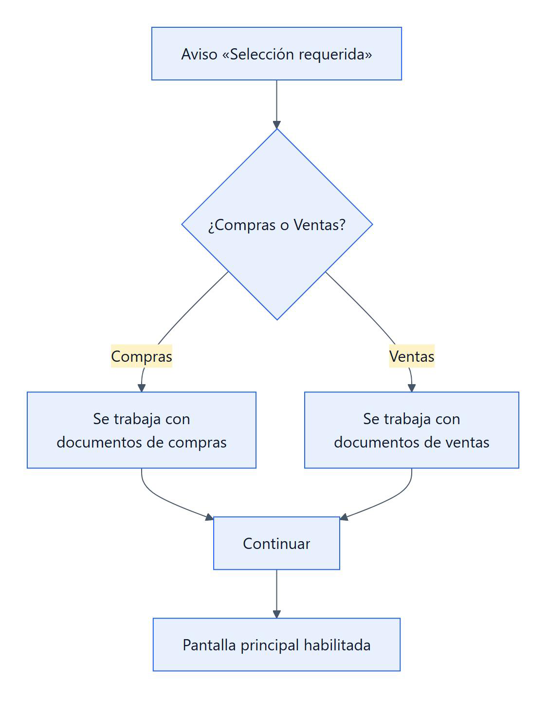</p>

Después se puede cambiar de tipo con las opciones **Compras / Ventas** del encabezado. Al hacerlo, la pantalla **se limpia** (archivo cargado y resultados) para no mezclar información de un tipo con el otro. Esto solo limpia lo que se ve; no borra nada de lo que ya está guardado en el sistema.

## 7. Paso 2 — Cargar el archivo Excel

- Se acepta únicamente un archivo **Excel (.xlsx)** con los documentos FEL.
- El archivo se puede **arrastrar** al recuadro o seleccionar con un **clic**.
- El sistema lee el archivo y muestra la **lista de hojas** que contiene.
  - Si el archivo tiene **una sola hoja**, se elige sola.
  - Si tiene **varias**, el usuario elige en cuál están los datos.
- Se muestra el nombre y tamaño del archivo, con una **X** para quitarlo y cargar otro.

Con el archivo cargado y la hoja elegida, la pantalla queda como se ve en la imagen de la sección 5 (puntos 2, 3 y 4).

<p align="center">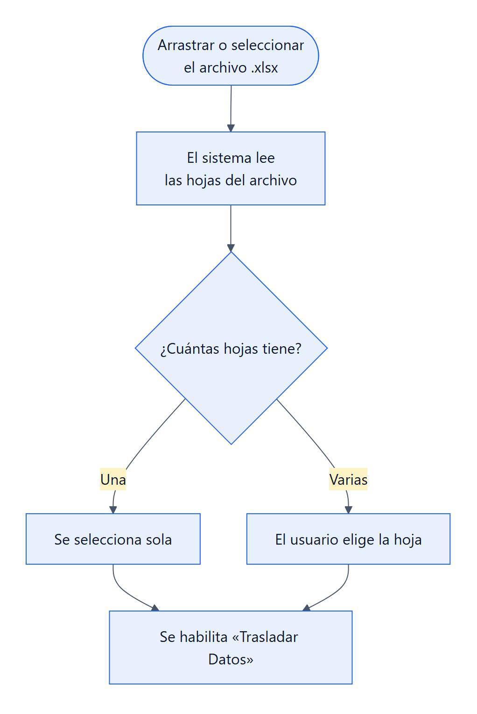</p>

> Solo se trabaja con un archivo a la vez. Para cambiarlo, primero se quita el actual con la **X**.

## 8. Paso 3 — Trasladar los datos

Al pulsar **Trasladar Datos**, el sistema pide confirmación: *«¿Está seguro de que desea guardar los datos?»*. En esa misma ventana aparece una opción importante:

> **☐ Eliminar data antes de trasladar**
>
> Si se marca, el sistema **borra primero los documentos cargados anteriormente** (del tipo elegido, compras o ventas) y después guarda los del archivo nuevo. Sirve para **reemplazar** una carga anterior, por ejemplo si se cargó un archivo equivocado o incompleto. Si no se marca, los documentos nuevos se **agregan** a los que ya existen.

<p align="center">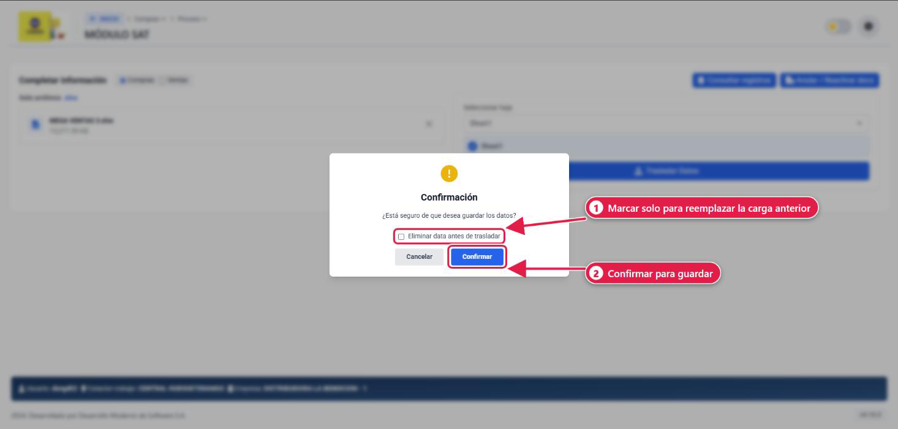<br>
<i>Figura 3. Ventana de confirmación del traslado</i></p>

1. **Eliminar data antes de trasladar**: márquela solo si quiere reemplazar lo cargado anteriormente.
2. **Confirmar**: inicia el traslado. **Cancelar** cierra la ventana sin guardar nada.

<p align="center">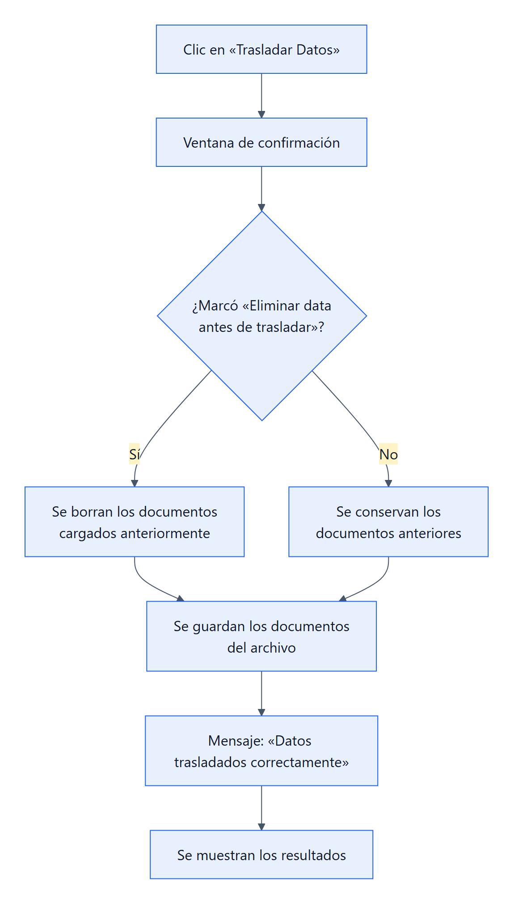</p>

Mientras el sistema trabaja, aparece la pantalla de **«Cargando datos...»** y no se puede usar la pantalla hasta que termine. Si ocurre un problema, se muestra un mensaje de error explicando lo sucedido, para poder corregirlo y volver a intentar el traslado.

## 9. Paso 4 — Revisar el resultado

Terminado el traslado, la pantalla muestra tres cosas:

<p align="center">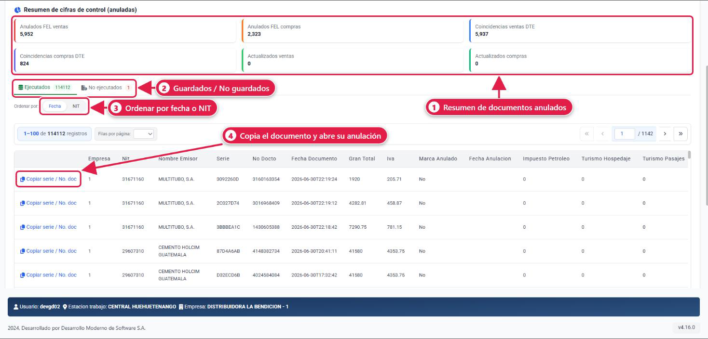<br>
<i>Figura 4. Resultado del traslado: resumen de anulados, pestañas y tabla de documentos</i></p>

1. **Resumen de cifras de control (anuladas)**: seis tarjetas con el resumen de documentos anulados.
2. **Ejecutados / No ejecutados**: pestañas con los documentos guardados y las filas que no se pudieron guardar. Cada una muestra cuántos registros tiene.
3. **Ordenar por**: cambia el orden de la tabla entre fecha y NIT.
4. **Copiar serie / No. doc**: copia los datos del documento y lleva directo a su anulación.

### 9.1 Resumen de cifras de control (anuladas)

Seis tarjetas que resumen cómo quedó la información de documentos anulados después de la carga:

| Tarjeta | Qué indica |
|---|---|
| **Anulados FEL ventas** | Documentos de ventas que vienen marcados como anulados. |
| **Anulados FEL compras** | Documentos de compras que vienen marcados como anulados. |
| **Coincidencias ventas DTE** | Documentos de ventas anulados que se encontraron registrados en el sistema. |
| **Coincidencias compras DTE** | Documentos de compras anulados que se encontraron registrados en el sistema. |
| **Actualizados ventas** | Documentos de ventas cuyo estado se actualizó. |
| **Actualizados compras** | Documentos de compras cuyo estado se actualizó. |

### 9.2 Ejecutados y No ejecutados

Dos pestañas, cada una con su contador:

<p align="center">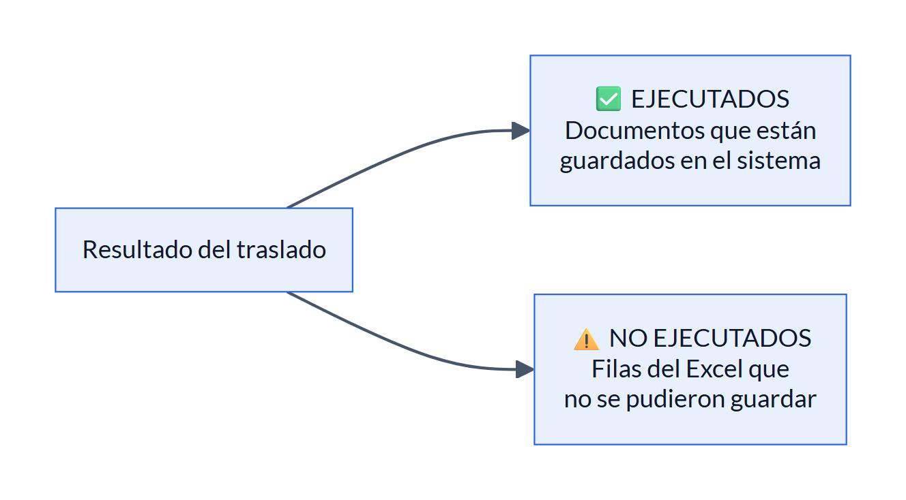</p>

- **Ejecutados**: muestra los documentos guardados del tipo elegido. Se pueden **ordenar por fecha o por NIT**. Ojo: incluye **todos** los documentos guardados de ese tipo para la empresa, no solo los del último archivo.
- **No ejecutados**: muestra las filas del archivo que el sistema no pudo guardar.

### 9.3 Atajo: del documento a su anulación

En la tabla de Ejecutados, cada documento tiene la opción **«Copiar serie / No. doc»**. Al usarla:

1. Se copia la serie y el número del documento (para pegarlo donde se necesite).
2. El sistema cambia a la vista de anulación y **busca ese documento automáticamente**, listo para anularlo o reactivarlo (ver la imagen de la sección 12.2).

## 10. Consultar documentos ya guardados

No es necesario cargar un archivo para ver lo que ya está en el sistema. El botón **Consultar registros** muestra todos los documentos guardados del tipo elegido (compras o ventas), ordenados por fecha. Desde ahí se puede:

- Cambiar el orden (fecha o NIT).
- Calcular los totales de impuestos.
- Ir a anular o reactivar un documento.

## 11. Totales de impuestos (cifras de control)

Dentro de la pestaña **Ejecutados**, el usuario puede elegir un **rango de fechas** (opcional) y pulsar **Consultar cifras**. El sistema responde con:

- La **cantidad de documentos** encontrados en ese periodo.
- Una tarjeta por cada impuesto que tenga monto, con el símbolo de moneda de la empresa:

| | | |
|---|---|---|
| Gran total | IVA | Impuesto petróleo |
| Turismo hospedaje | Turismo pasajes | Timbre de prensa |
| Bomberos | Tasa municipal | Bebidas alcohólicas |
| Bebidas no alcohólicas | Tabaco | Cemento |
| Tarifa portuaria | | |

Los impuestos que suman cero no se muestran, para que la vista quede limpia.

<p align="center">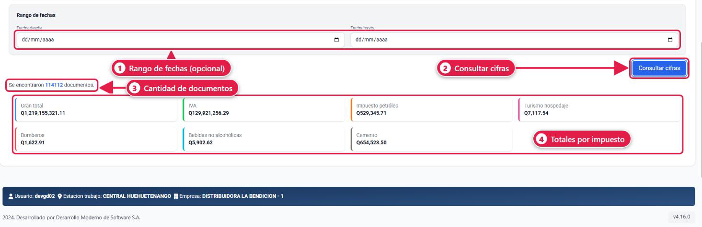<br>
<i>Figura 5. Consulta de totales de impuestos por rango de fechas</i></p>

1. **Rango de fechas**: desde y hasta. Si se deja vacío, se toman todos los documentos.
2. **Consultar cifras**: calcula los totales.
3. **Cantidad de documentos** incluidos en el cálculo.
4. **Totales por impuesto**: una tarjeta por cada impuesto con monto.

<p align="center">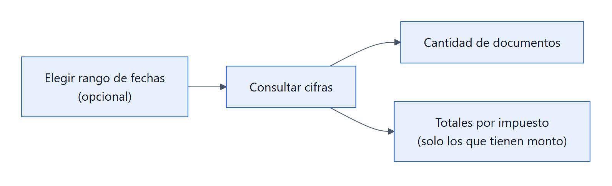</p>

> Si no se elige un rango, se calculan los totales de **todos** los documentos guardados del tipo. No se permite elegir fechas futuras.

## 12. Anular o reactivar documentos

Esta vista sirve para **corregir el estado** de los documentos: marcar como **anulado** un documento que fue anulado ante la SAT, o **reactivar** uno que se anuló por error.

### 12.1 Buscar

Se puede buscar por **serie**, **número de documento** y/o **rango de fechas**, y pulsar **Consultar**. El botón **Limpiar** borra los filtros.

<p align="center">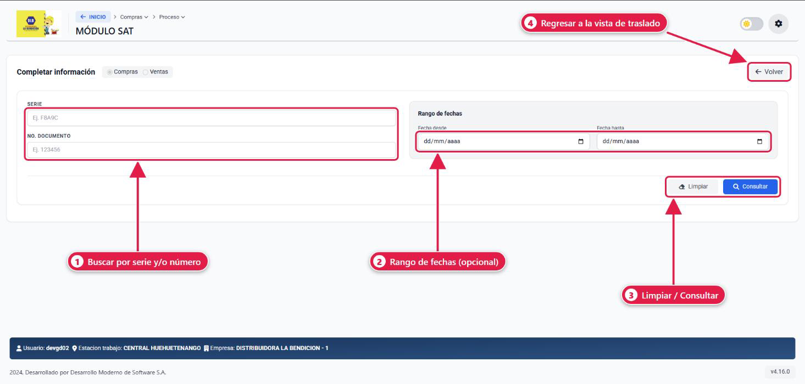<br>
<i>Figura 6. Vista de anulación: filtros de búsqueda</i></p>

1. **Serie** y **número de documento**: para buscar un documento en particular.
2. **Rango de fechas** (opcional): para buscar los documentos de un periodo.
3. **Limpiar / Consultar**: borra los filtros o ejecuta la búsqueda.
4. **Volver**: regresa a la vista de traslado.

Mientras se está en esta vista, las opciones **Compras / Ventas quedan bloqueadas**: se trabaja con el tipo que se eligió antes de entrar.

Cada documento encontrado se muestra como una tarjeta con: emisor, NIT, serie, número, fecha, total, IVA y su **estado actual** (**Activo** en verde o **Anulado** en rojo, con la fecha de anulación).

### 12.2 Marcar cambios (sin guardar todavía)

Cada tarjeta tiene un botón según su estado:

- Si está **activo** → **Anular Documento**.
- Si está **anulado** → **Reactivar Documento**.

Al pulsarlo, el cambio **no se guarda de inmediato**: la tarjeta queda marcada como **«Cambio pendiente»** (resaltada en ámbar) y aparece el botón **Deshacer cambio**. Esto permite marcar varios documentos con calma y revisarlos antes de aplicar.

<p align="center">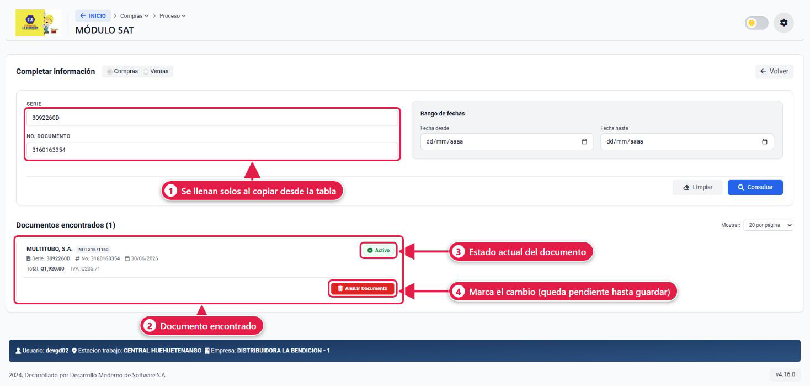<br>
<i>Figura 7. Vista de anulación: documento encontrado listo para anular</i></p>

1. **Serie y número ya llenos**: llegaron así porque se usó «Copiar serie / No. doc» en la tabla de Ejecutados.
2. **Documento encontrado**: emisor, NIT, serie, número, fecha, total e IVA.
3. **Estado actual**: Activo (verde) o Anulado (rojo).
4. **Anular Documento**: marca el cambio. Queda pendiente hasta pulsar Guardar cambios.

<p align="center">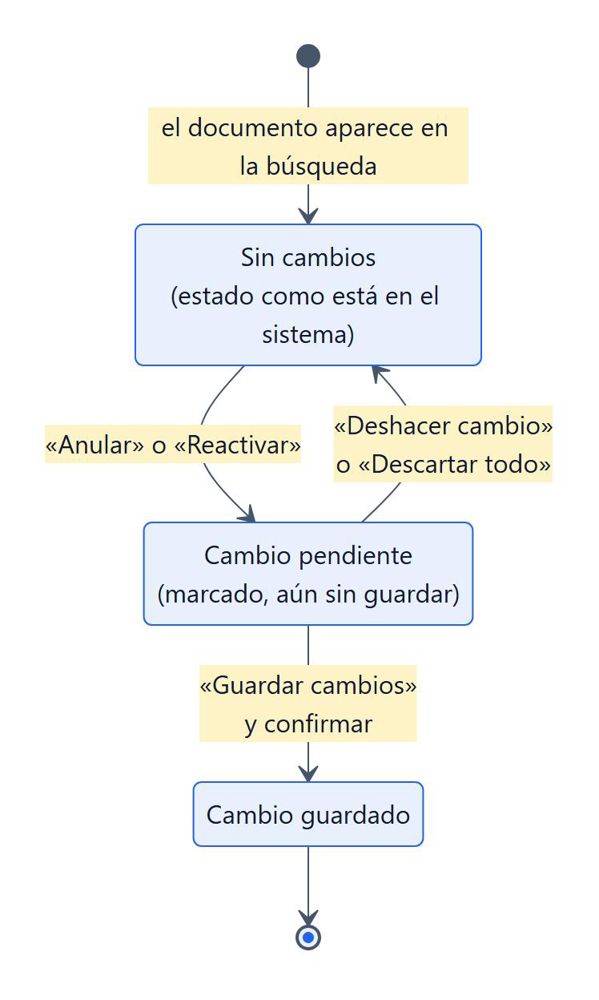</p>

> Los cambios pendientes se conservan aunque se haga otra búsqueda. Así se pueden buscar y marcar documentos de distintas series y guardarlos todos juntos al final.

### 12.3 Guardar

Mientras haya cambios pendientes, en la parte inferior se ve una barra con el conteo, por ejemplo: **«3 cambio(s) pendiente(s) (2 a anular) (1 a reactivar)»**, con los botones **Descartar todo** y **Guardar cambios**.

<p align="center">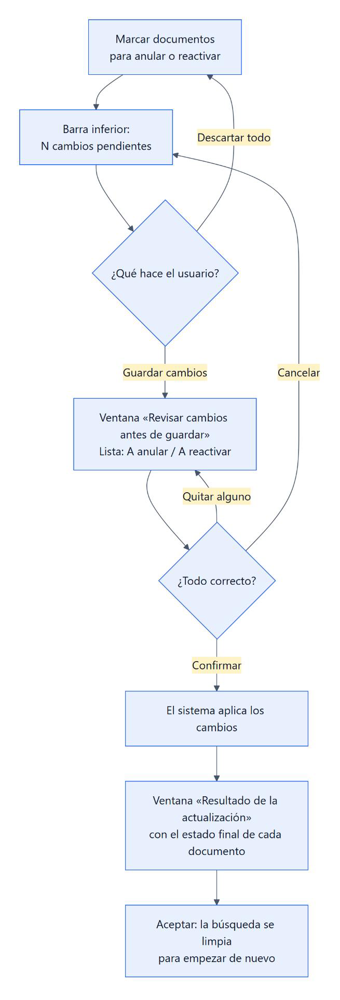</p>

La ventana de revisión es una **última verificación**: muestra por separado los documentos que se van a anular y los que se van a reactivar, y permite quitar de la lista cualquiera que se haya marcado por error.

## 13. El recorrido completo

<p align="center">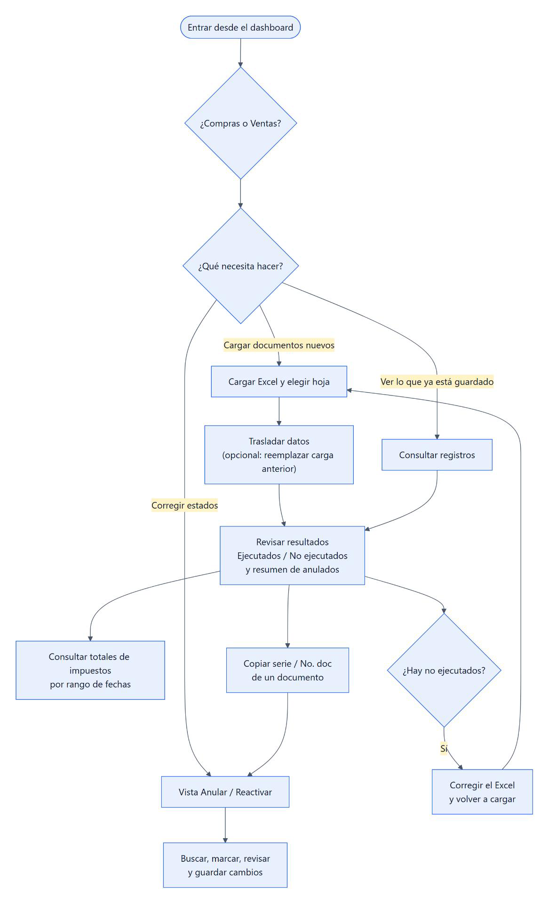</p>

## 14. Preguntas frecuentes y recomendaciones

**¿Puedo cargar compras y ventas en el mismo archivo?** No. Cada traslado es de un solo tipo. Se elige Compras o Ventas, se carga el archivo correspondiente y luego, si hace falta, se cambia de tipo y se carga el otro.

**¿Qué pasa si cargo un Excel que ya había cargado antes?** No se duplica la información. El sistema le notifica esos registros como **No ejecutados**, porque ya existen en el sistema. Basta con revisar esa lista para confirmar que el motivo es ese; no hace falta eliminar la data y volver a cargar el archivo.

**¿Por qué «Ejecutados» muestra más documentos de los que tenía mi archivo?** Porque esa pestaña muestra todos los documentos guardados del tipo elegido para la empresa, incluidos los de cargas anteriores, cuadrar con los totales de impuestos y el rango de fechas.

**Quiero trasladar otra vez y el botón está deshabilitado.** Después de un traslado exitoso, la hoja seleccionada se limpia. Vuelva a elegir la hoja (o quite el archivo y cargue uno nuevo).

**¿Cambiar entre Compras y Ventas borra mis datos?** No borra nada del sistema; solo limpia lo que se ve en pantalla para empezar con el otro tipo.

**¿Se guardan los cambios de anulación apenas pulso «Anular Documento»?** No. Quedan como pendientes hasta que se pulsa **Guardar cambios** y se confirma en la ventana de revisión.

**Refresqué la página y me sacó al Menú.** Es el comportamiento normal: hay que volver a entrar al aplicativo desde el Menú.

**El Excel tiene varias hojas, ¿cuál elijo?** La que contiene el listado de documentos FEL. El sistema solo procesa la hoja seleccionada.

## 15. Resumen

| Pregunta | Respuesta |
|---|---|
| **¿Qué hace?** | Lleva al sistema los documentos FEL de compras o ventas desde un Excel, y permite revisarlos, totalizar sus impuestos y corregir su estado de anulación. |
| **¿Quién lo usa?** | Personal contable o administrativo que maneja la información fiscal de la empresa. |
| **¿Qué necesita?** | Haber iniciado sesión con la empresa correcta y un archivo Excel (.xlsx) con los documentos FEL. |
| **¿Qué entrega?** | Documentos guardados, lista de filas con problemas, resumen de anulados y totales de impuestos por periodo. |
| **¿En qué ayuda?** | Ahorra digitación, reduce errores, facilita el control fiscal y mantiene al día el estado de los documentos. |

---

# Parte B. Documentación técnica

| Dato | Detalle |
|---|---|
| Aplicativo | Carga Factura Fel Excel (`prcFacturaFelCompra`), módulo SAT |
| Frontend | Angular |
| Backend | ApiBusiness (ASP.NET Core 8), carpetas `Controllers/ComprasSAT`, `Controllers/MigrarExcel` y `Controllers/Shared` |
| Base de datos | SQL Server. Revisado en `DLBENDICION_20260708_1449_ac` (copia de desarrollo de DLB) |
| Fecha de esta parte | 09/11/2026 |


## B1. Arquitectura del proceso

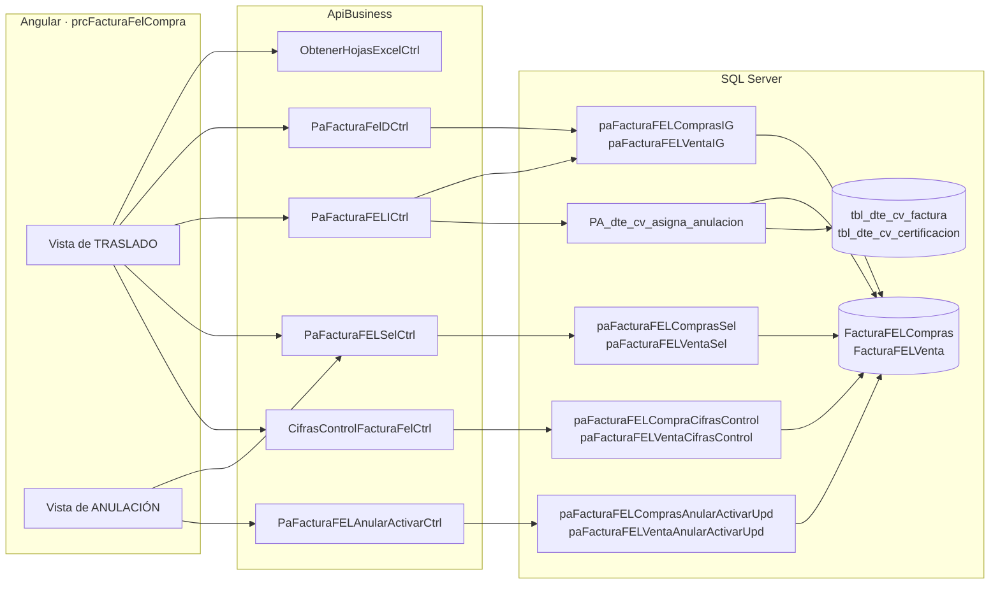

**Regla general:** casi todos los endpoints reciben `Tipo` (**1 = Compras**, **2 = Ventas**) y con eso eligen el procedimiento y la tabla:

| Tipo | Tabla | Procedimientos |
|---|---|---|
| 1 · Compras | `FacturaFELCompras` | `paFacturaFELComprasIG`, `paFacturaFELComprasSel`, `paFacturaFELCompraCifrasControl`, `paFacturaFELComprasAnularActivarUpd` |
| 2 · Ventas | `FacturaFELVenta` | `paFacturaFELVentaIG`, `paFacturaFELVentaSel`, `paFacturaFELVentaCifrasControl`, `paFacturaFELVentaAnularActivarUpd` |

Si `Tipo` no es 1 ni 2, el endpoint responde **400** con *"El parámetro 'Tipo' debe ser 1 (Compras) o 2 (Ventas)"*.

## B2. Endpoints que utiliza el proceso

Todos requieren JWT (`Authorization: Bearer <token>`) y, salvo el de hojas, responden con el envelope estándar `ApiResponseModel` (`status`, `message`, `error`, `errorCode`, `storedProcedure`, `parameters`, `data`, …). Los nombres de las propiedades llegan en camelCase.

| # | Paso de la guía | Método | Ruta | Procedimiento |
|---|---|---|---|---|
| 1 | Paso 2: leer las hojas del Excel | POST | `api/ObtenerHojasExcelCtrl` | — (lo lee el API con EPPlus) |
| 2 | Paso 3: «Eliminar data antes de trasladar» | POST | `api/PaFacturaFelDCtrl` | `paFacturaFEL…IG` `@Accion = 'D'` |
| 3 | Paso 3: Trasladar Datos | POST | `api/PaFacturaFELICtrl` | `paFacturaFEL…IG` `@Accion = 'I'` (una vez por fila) y `PA_dte_cv_asigna_anulacion` |
| 4 | Paso 4 / sección 10 / sección 12.1: Ejecutados, Consultar registros y buscar para anular | GET | `api/PaFacturaFELSelCtrl` | `paFacturaFEL…Sel` |
| 5 | Sección 11: Consultar cifras | GET | `api/CifrasControlFacturaFelCtrl` | `paFacturaFEL…CifrasControl` |
| 6 | Sección 12.3: Guardar cambios | POST | `api/PaFacturaFELAnularActivarCtrl` | `paFacturaFEL…AnularActivarUpd` |

### B2.1 Leer las hojas del Excel: `POST api/ObtenerHojasExcelCtrl`

**Body (`multipart/form-data`):**

| Campo | Tipo | Detalle |
|---|---|---|
| `ArchivoExcel` | archivo | El `.xlsx` |

**Respuesta 200:** un arreglo simple con los nombres de las hojas (no viene dentro del envelope):

```json
["Hoja1", "FEL Compras"]
```

Si el archivo no se puede leer responde **500** con el envelope y el detalle en `error`.

### B2.2 Eliminar data antes de trasladar: `POST api/PaFacturaFelDCtrl`

Se llama **solo si** el usuario marcó «Eliminar data antes de trasladar», antes de B2.3.

**Body (JSON):**

```json
{ "userName": "usuario", "tipo": 1 }
```

**Qué hace:** ejecuta `paFacturaFEL…IG` con `@Accion = 'D'`, que hace `DELETE FROM FacturaFEL… WHERE UserName = @UserName`. Borra los documentos de ese tipo **cargados por ese usuario** (ver B8, punto 1).

**Respuesta 200:** `data: "Facturas eliminadas correctamente."`

### B2.3 Trasladar Datos: `POST api/PaFacturaFELICtrl`

**Body (`multipart/form-data`):**

| Campo | Tipo | Detalle |
|---|---|---|
| `ArchivoExcel` | archivo | El `.xlsx` |
| `NombreHojaExcel` | string | Hoja elegida (B2.1) |
| `pUserName` | string | Usuario de la sesión. Se guarda en `UserName` |
| `pEmpresa` | number | Empresa de la sesión |
| `Tipo` | number | 1 = Compras, 2 = Ventas |

**Qué hace, en orden:**

1. **Valida los encabezados** de la fila 1 (sección B3). Si falta una columna obligatoria responde **400**: *"Las columnas del archivo Excel no coinciden."* con la lista en `error`, y no guarda nada.
2. **Lee las filas** desde la fila 2:
   - Las filas sin serie o sin número de DTE se **saltan** sin error.
   - Si el NIT viene vacío se guarda **`C/F`**.
   - Si la fecha de emisión no es válida, o falta nombre, gran total, IVA o marca de anulado, la fila se anota como error.
3. Si hubo **algún error de formato**, responde **400**: *"Se encontraron errores en el archivo Excel."* con todos los errores en `error` (por ejemplo `Fila 15, Columna H: Formato inválido para Fecha de Emisión.`), y **no guarda nada**.
4. **Guarda por lotes de 500 filas**, una transacción por lote. Cada fila llama `paFacturaFEL…IG` con `@Accion = 'I'`. Si una fila falla (por ejemplo, *Factura duplicada*), se agrega a **No ejecutados** y el lote sigue.
5. Al terminar, ejecuta **`PA_dte_cv_asigna_anulacion`**, que marca como anuladas en el DTE las facturas que vienen anuladas en el FEL y devuelve las 6 cifras de la sección 9.1.

**Respuesta 200:**

```json
{
  "status": true,
  "message": "Migración completada por lotes y conciliación de anulados ejecutada.",
  "storedProcedure": "paFacturaFELComprasIG",
  "data": {
    "noEjecutados": [
      { "empresa": 1, "nit": "1234567", "nombreEmisor": "PROVEEDOR, S.A.", "serie": "8F70B2B2", "noDocto": "95439373",
        "fechaDocumento": "2026-10-01T00:00:00", "granTotal": 1500.00, "iva": 160.71, "marcaAnulado": "No", "fechaAnulacion": null,
        "impuestoPetroleo": null, "...": "...", "cuenta": null, "id_Cuenta": null, "userName": "usuario", "fechaHora": "2026-11-09T10:15:00" }
    ],
    "cifrasAnulacion": [
      { "anulados_FEL_Ventas": 5952, "anulados_FEL_Compras": 310, "coincidencias_Ventas_DTE": 120,
        "coincidencias_Compras_DTE": 15, "actualizados_Ventas": 3, "actualizados_Compras": 0 }
    ]
  }
}
```

- `noEjecutados`: filas que no se guardaron (pestaña **No ejecutados**). No incluye el motivo de cada una.
- `cifrasAnulacion`: las 6 tarjetas de la sección 9.1. Si el procedimiento de anulación falla, viene en `null` y el traslado igual se da por exitoso.

### B2.4 Documentos guardados: `GET api/PaFacturaFELSelCtrl`

Lo usa la pestaña **Ejecutados**, **Consultar registros** y la **búsqueda de la vista de anulación**.

| Parámetro (query) | Tipo | Obligatorio | Detalle |
|---|---|---|---|
| `Tipo` | number | Sí | 1 = Compras, 2 = Ventas |
| `OrdenarPor` | number | Sí | 1 = fecha del documento (más reciente primero), 2 = NIT |
| `pEmpresa` | number | Sí | Empresa de la sesión |
| `pSerie` | string | No | Serie exacta |
| `pNoDocto` | string | No | Número de documento exacto |
| `pFechaInicio` | fecha | No | Desde (incluida) |
| `pFechaFin` | fecha | No | Hasta (incluida, con hora: `2026-10-31T23:59:59`) |

`GET api/PaFacturaFELSelCtrl?Tipo=1&OrdenarPor=1&pEmpresa=1&pSerie=8F70B2B2&pNoDocto=95439373`

**Respuesta 200:** un documento por fila, con todas las columnas de la tabla menos `MUserName`, `MFechaHora` y `Estado`:

```json
"data": [
  { "empresa": 1, "nit": "1234567", "nombreEmisor": "PROVEEDOR, S.A.", "serie": "8F70B2B2", "noDocto": "95439373",
    "fechaDocumento": "2026-10-01T00:00:00", "granTotal": 1500.00, "iva": 160.71, "marcaAnulado": "No", "fechaAnulacion": null,
    "impuestoPetroleo": 0, "turismoHospedaje": 0, "turismoPasajes": 0, "timbrePrensa": 0, "bomberos": 0, "tasaMunicipal": 0,
    "bebidasAlcoholicas": 0, "tabaco": 0, "cemento": 0, "bebidasNoAlcoholicas": 0, "tarifaPortuaria": 0,
    "cuenta": null, "id_Cuenta": null, "userName": "usuario", "fechaHora": "2026-11-09T10:15:00" }
]
```

`marcaAnulado` es `"Si"` o `"No"`; con eso se pinta **Anulado** (rojo) o **Activo** (verde).

### B2.5 Totales de impuestos: `GET api/CifrasControlFacturaFelCtrl`

| Parámetro (query) | Tipo | Obligatorio | Detalle |
|---|---|---|---|
| `Tipo` | number | Sí | 1 = Compras, 2 = Ventas |
| `pEmpresa` | number | Sí | Empresa de la sesión |
| `FechaInicio` | fecha | No | Desde (incluida) |
| `FechaFin` | fecha | No | Hasta (incluye todo ese día) |

**Respuesta 200:** una sola fila:

```json
"data": [
  { "cantidadDocumentos": 1250, "granTotal": 1520300.55, "iva": 162889.34, "impuestoPetroleo": 0, "turismoHospedaje": 0,
    "turismoPasajes": 0, "timbrePrensa": 0, "bomberos": 0, "tasaMunicipal": 0, "bebidasAlcoholicas": 0,
    "tabaco": 0, "cemento": 0, "bebidasNoAlcoholicas": 0, "tarifaPortuaria": 0 }
]
```

La pantalla oculta las tarjetas con total 0 (sección 11).

### B2.6 Guardar anulaciones y reactivaciones: `POST api/PaFacturaFELAnularActivarCtrl`

Se llama una sola vez al confirmar la ventana de revisión, con **todos** los cambios pendientes.

**Body (JSON):**

```json
{
  "tipo": 2,
  "pEmpresa": 1,
  "pUserName": "usuario",
  "pJson": "[{\"Serie\":\"8F70B2B2\",\"NoDocto\":\"95439373\",\"MarcaAnulado\":\"Si\"},{\"Serie\":\"ABC12345\",\"NoDocto\":\"1234567890\",\"MarcaAnulado\":\"No\"}]"
}
```

`pJson` es un **texto** con un arreglo JSON. `MarcaAnulado`: `"Si"` = anular, `"No"` = reactivar.

**Qué hace:** en una transacción actualiza `MarcaAnulado`, `FechaAnulacion` (fecha y hora actual al anular, `NULL` al reactivar), `MUserName` y `MFechaHora` de los documentos de esa empresa con esa serie y número.

**Respuesta 200:** los documentos como quedaron (mismo formato de B2.4), para la ventana «Resultado de la actualización».

**Errores (HTTP 500, `errorCode: "1-<número>"`):**

| Código | Mensaje |
|---|---|
| `1-50002` | El parámetro @pJson no contiene un JSON válido. |
| `1-50003` | MarcaAnulado debe ser "Si" o "No" para todos los documentos. |

### B2.7 Otros endpoints del mismo módulo (no los usa esta pantalla)

| Método | Ruta | Procedimiento | Uso |
|---|---|---|---|
| GET | `api/PaFacturaFELGCtrl?Empresa&Nit&Tipo&FiltroCuenta` | `paFacturaFEL…IG` `@Accion = 'G'` | Documentos de un NIT, con o sin cuenta contable |
| POST | `api/PaFacturaFELUCtrl` (form-data `Empresa`, `Nit`, `Cuenta`, `IdCuenta`, `Tipo`) | `paFacturaFELComprasIG` `@Accion = 'U'` | Asignar la cuenta contable a los documentos de un NIT |

## B3. Formato del archivo Excel

- Solo se lee la **hoja elegida**. La **fila 1** son los encabezados y los datos empiezan en la **fila 2**.
- Los encabezados se comparan **sin tildes, sin mayúsculas, sin espacios y sin signos** (`. , ; : - _ ( ) [ ] { } " /`). Por ejemplo, «NIT del emisor» se lee como `nitdelemisor`. El orden de las columnas no importa.

**Columnas obligatorias** (si falta alguna, no se guarda nada):

| Encabezado (como lo exporta la SAT) | Se lee como | Columna en la tabla |
|---|---|---|
| NIT del emisor | `nitdelemisor` | `Nit` (vacío = `C/F`) |
| Nombre completo del emisor | `nombrecompletodelemisor` | `NombreEmisor` |
| Gran Total (Moneda Original) | `grantotalmonedaoriginal` | `GranTotal` |
| IVA (monto de este impuesto) | `ivamontodeesteimpuesto` | `IVA` |
| Marca de anulado | `marcadeanulado` | `MarcaAnulado` (`Si` / `No`) |
| Serie | `serie` | `Serie` |
| Número del DTE | `numerodeldte` | `NoDocto` |
| Fecha de emisión | `fechadeemision` | `FechaDocumento` |

**Columnas opcionales** (si no vienen, el impuesto se guarda en 0):

| Encabezado | Se lee como | Columna en la tabla |
|---|---|---|
| Fecha de anulación | `fechadeanulacion` | `FechaAnulacion` |
| Petróleo (monto de este impuesto) | `petroleomontodeesteimpuesto` | `ImpuestoPetroleo` |
| Turismo Hospedaje (monto de este impuesto) | `turismohospedajemontodeesteimpuesto` | `TurismoHospedaje` |
| Turismo Pasajes (monto de este impuesto) | `turismopasajesmontodeesteimpuesto` | `TurismoPasajes` |
| Timbre de Prensa (monto de este impuesto) | `timbredeprensamontodeesteimpuesto` | `TimbrePrensa` |
| Bomberos (monto de este impuesto) | `bomberosmontodeesteimpuesto` | `Bomberos` |
| Tasa Municipal (monto de este impuesto) | `tasamunicipalmontodeesteimpuesto` | `TasaMunicipal` |
| Bebidas alcohólicas (monto de este impuesto) | `bebidasalcoholicasmontodeesteimpuesto` | `BebidasAlcoholicas` |
| Tabaco (monto de este impuesto) | `tabacomontodeesteimpuesto` | `Tabaco` |
| Cemento (monto de este impuesto) | `cementomontodeesteimpuesto` | `Cemento` |
| Bebidas no Alcohólicas (monto de este impuesto) | `bebidasnoalcoholicasmontodeesteimpuesto` | `BebidasNoAlcoholicas` |
| Tarifa Portuaria (monto de este impuesto) | `tarifaportuariamontodeesteimpuesto` | `TarifaPortuaria` |
| Cuenta | `cuenta` | `Cuenta` |
| Id Cuenta | `idcuenta` | `Id_Cuenta` |

**Validaciones de cada fila al guardar** (`paFacturaFEL…IG`, `@Accion = 'I'`). Si una falla, la fila pasa a **No ejecutados**:

| Código | Regla |
|---|---|
| 50001 | La serie FEL debe tener exactamente 8 caracteres. |
| 50002 | NoDocto debe ser de 1 a 10 dígitos numéricos. |
| 50003 | Fecha del documento y gran total son obligatorios. |
| 50004 | GranTotal no puede ser negativo. |
| 50005 | Factura duplicada: ya existe la misma empresa, NIT, serie y número. |

## B4. Procedimientos almacenados

| Procedimiento | Lo llama | Qué hace | Tablas |
|---|---|---|---|
| `paFacturaFELComprasIG` / `paFacturaFELVentaIG` | B2.2, B2.3 (y B2.7) | `@Accion`: **I** inserta un documento (con las validaciones de B3), **G** consulta por NIT, **U** asigna cuenta contable por NIT, **D** borra lo cargado por un usuario | `FacturaFELCompras` / `FacturaFELVenta` |
| `paFacturaFELComprasSel` / `paFacturaFELVentaSel` | B2.4 | Consulta los documentos de la empresa con filtros opcionales y orden por fecha o NIT | `FacturaFELCompras` / `FacturaFELVenta` |
| `paFacturaFELCompraCifrasControl` / `paFacturaFELVentaCifrasControl` | B2.5 | Cantidad de documentos y suma de cada impuesto, por empresa y rango de fechas | `FacturaFELCompras` / `FacturaFELVenta` |
| `paFacturaFELComprasAnularActivarUpd` / `paFacturaFELVentaAnularActivarUpd` | B2.6 | Anula o reactiva una lista de documentos (JSON) en una transacción y los devuelve | `FacturaFELCompras` / `FacturaFELVenta` |
| `PA_dte_cv_asigna_anulacion` | B2.3 (al final) | Cuenta los anulados del FEL, busca sus coincidencias en el DTE por serie y número, y pone `Estado = 0` en las facturas DTE que coinciden | Lee `FacturaFELVenta`, `FacturaFELCompras`, `tbl_dte_cv_certificacion`; actualiza `tbl_dte_cv_factura` |

## B5. Tablas donde se guarda la información

### `FacturaFELCompras` y `FacturaFELVenta`

Las dos tienen **la misma estructura**: una guarda los documentos de compras y la otra los de ventas. Según el comentario del procedimiento, son tablas **transitorias**: se cargan desde el Excel de la SAT para conciliar y controlar.

| Columna | Tipo | Nulo | Default | Detalle |
|---|---|---|---|---|
| **Empresa** | tinyint | No | | PK. Empresa de la sesión |
| **Nit** | nvarchar(13) | No | | PK. NIT del emisor (`C/F` si viene vacío) |
| NombreEmisor | varchar(max) | No | | |
| FechaDocumento | datetime | No | | Fecha de emisión |
| **Serie** | varchar(13) | No | | PK. 8 caracteres en FEL |
| **NoDocto** | varchar(16) | No | | PK. Número del DTE |
| GranTotal | decimal(18,2) | No | | |
| IVA | decimal(18,2) | Sí | 0 | |
| MarcaAnulado | varchar(2) | Sí | | `Si` / `No` |
| FechaAnulacion | datetime | Sí | | Del Excel, o la fecha en que se anuló desde la pantalla |
| ImpuestoPetroleo, TurismoHospedaje, TurismoPasajes, TimbrePrensa, Bomberos, TasaMunicipal, BebidasAlcoholicas, Tabaco, Cemento, BebidasNoAlcoholicas, TarifaPortuaria | decimal(18,2) | Sí | 0 | Un monto por impuesto |
| Cuenta | smallint | Sí | | Cuenta contable (B2.7) |
| Id_Cuenta | varchar(50) | Sí | | Id de la cuenta contable |
| UserName | varchar(30) | Sí | | Quién cargó el documento |
| FechaHora | datetime | No | `GETDATE()` | Cuándo se cargó |
| MUserName | varchar(30) | Sí | | Quién lo anuló o reactivó |
| MFechaHora | datetime | Sí | | Cuándo se anuló o reactivó |
| Estado | tinyint | No | 1 | No lo usa este proceso |

- **Llave primaria:** `Empresa, Nit, Serie, NoDocto` (`PK_FacturaFEL` en compras y `PK_FacturaFELVenta` en ventas). No tienen llaves foráneas ni triggers.
- **Registros en la copia de DLB:** `FacturaFELCompras` 124,295 y `FacturaFELVenta` 278,478 (5,952 anuladas).

### Tablas del DTE que actualiza el proceso

`PA_dte_cv_asigna_anulacion` usa estas tablas, que **no son de este proceso**: son las facturas DTE de compras y ventas que ya tiene el sistema.

| Tabla | Columnas que usa | Uso |
|---|---|---|
| `tbl_dte_cv_factura` | `Id` (PK), `IdTipoOperacion` (1 = venta, 2 = compra), `Estado` (bit) | Se pone `Estado = 0` (anulada) cuando el FEL dice que el documento está anulado |
| `tbl_dte_cv_certificacion` | `IdFactura` (FK a `tbl_dte_cv_factura`), `Serie`, `Numero` | Para encontrar la factura DTE por serie y número |
| `tbl_dte_cv_tipo_operacion` | `Id`, `Nombre` | Catálogo: 1 = VENTA, 2 = COMPRA |

## B6. Diagrama entidad-relación

Las tablas FEL no tienen llaves foráneas. Su relación con el DTE es **lógica**: por serie y número (`Serie = Serie`, `NoDocto = Numero`) y por el tipo de operación (ventas = 1, compras = 2).

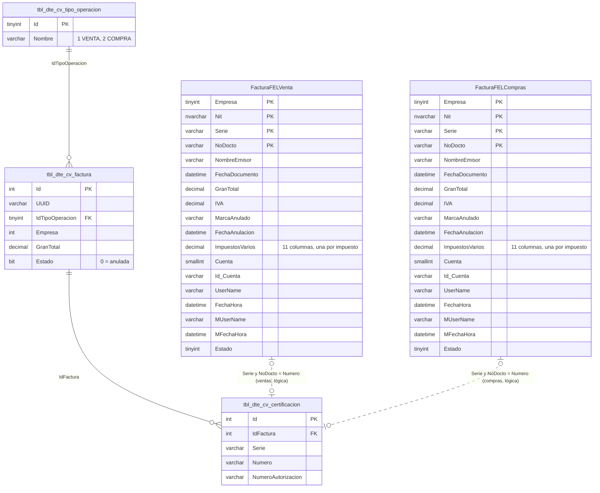

## B7. Diagramas de flujo técnicos

### B7.1 Trasladar datos (pasos 2 a 4)

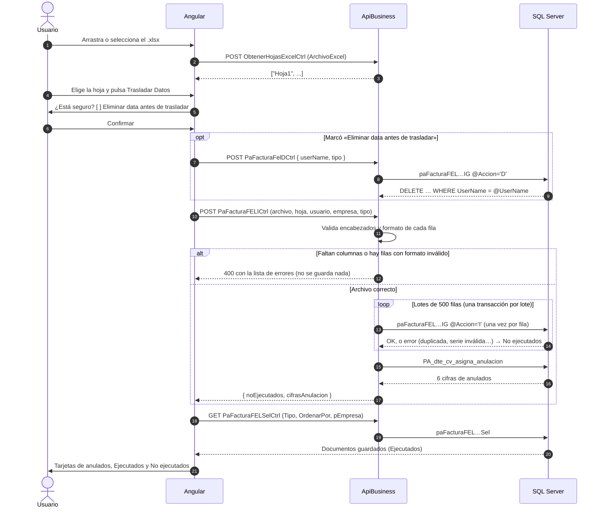

### B7.2 Guardado de cada fila (`@Accion = 'I'`)

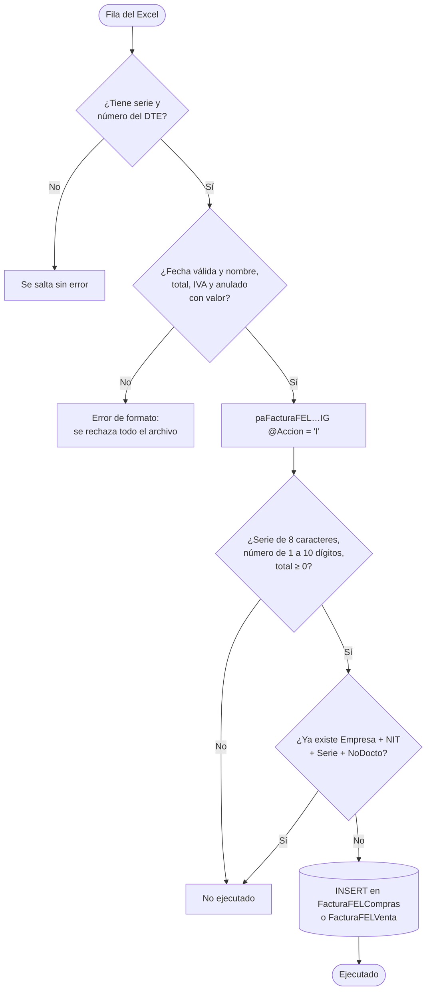

### B7.3 Conciliación de anulados con el DTE (`PA_dte_cv_asigna_anulacion`)

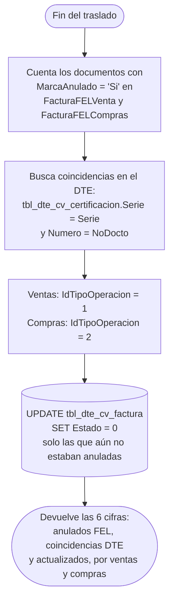

### B7.4 Anular o reactivar documentos (sección 12)

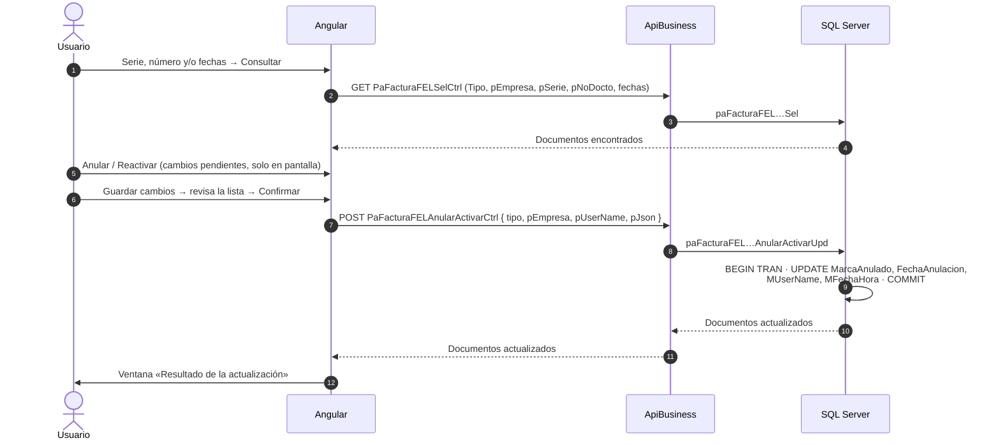

## B8. Observaciones técnicas

Puntos a tener en cuenta sobre el comportamiento actual del proceso.

| # | Observación | Dónde | Efecto |
|---|---|---|---|
| 1 | «Eliminar data antes de trasladar» borra por **usuario**, sin filtrar por empresa: `DELETE … WHERE UserName = @UserName`. | `paFacturaFEL…IG` `@Accion = 'D'` | Borra lo que ese usuario cargó en **todas** las empresas, no solo en la de la sesión. Tampoco borra lo cargado por otros usuarios en la misma empresa. |
| 2 | La conciliación de anulados no filtra por empresa y recorre las tablas completas de compras **y** ventas, sin importar el tipo que se cargó. | `PA_dte_cv_asigna_anulacion` | Las 6 cifras de la sección 9.1 son de todas las empresas y de todas las cargas, no solo del archivo recién cargado. |
| 3 | La conciliación solo **anula** en el DTE (`Estado = 0`); nunca reactiva. Y no se ejecuta al anular o reactivar desde la pantalla, solo al trasladar. | `PA_dte_cv_asigna_anulacion`, B2.6 | Un documento anulado a mano en la vista de anulación no se refleja en `tbl_dte_cv_factura` hasta el siguiente traslado. Uno reactivado nunca se reactiva en el DTE. |
| 4 | Al anular desde la pantalla, `FechaAnulacion` toma la **fecha y hora actual**, no la fecha de anulación ante la SAT. | `paFacturaFEL…AnularActivarUpd` | La fecha que se ve es la del cambio en el sistema. |
| 5 | Anular o reactivar busca por **serie y número** sin el NIT, que sí es parte de la llave. | `paFacturaFEL…AnularActivarUpd` | Si dos emisores tuvieran la misma serie y número en la empresa, se actualizarían los dos. |
| 6 | **No ejecutados** no dice el motivo de cada fila (duplicada, serie que no tiene 8 caracteres, número no numérico…). | `PaFacturaFELICtrl` | El usuario tiene que deducir el motivo. La guía (sección 14) asume que es por duplicado. |
| 7 | La consulta de documentos no tiene paginación. | `paFacturaFEL…Sel` | Sin filtros, devuelve todos los documentos del tipo para la empresa. En la copia de DLB hay 278,478 de ventas. |
| 8 | Los errores SQL responden con **HTTP 500** y en algunos endpoints sin `errorCode`. | B2.2 a B2.6 | Angular no puede distinguir por código un error de validación de una falla real. |
| 9 | `PaFacturaFELUCtrl` siempre ejecuta el procedimiento de **compras**, aunque reciba `Tipo = 2`. | B2.7 (no lo usa esta pantalla) | Asignar cuenta contable a ventas actualizaría compras. |
